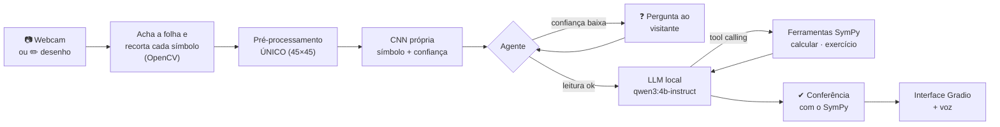
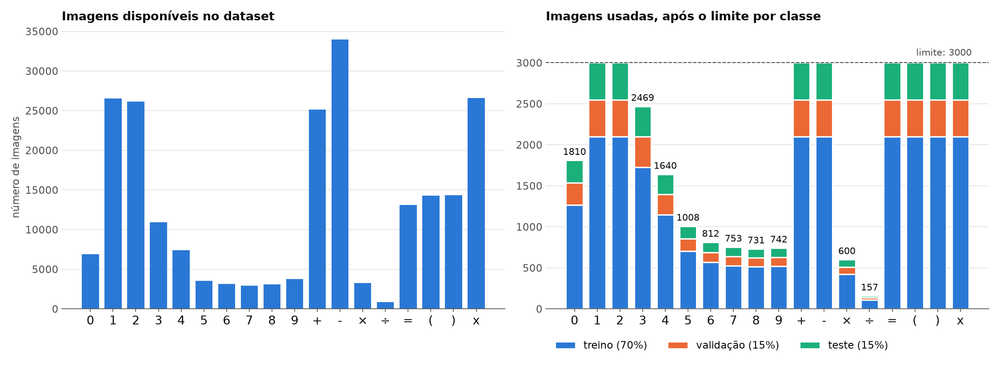
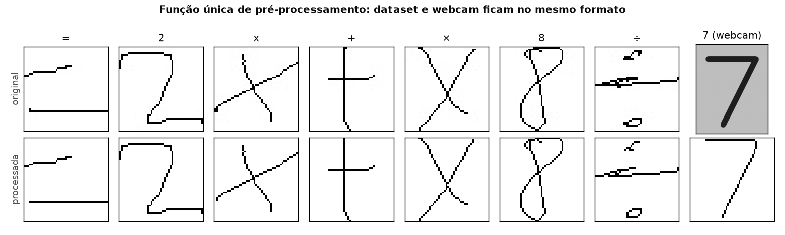
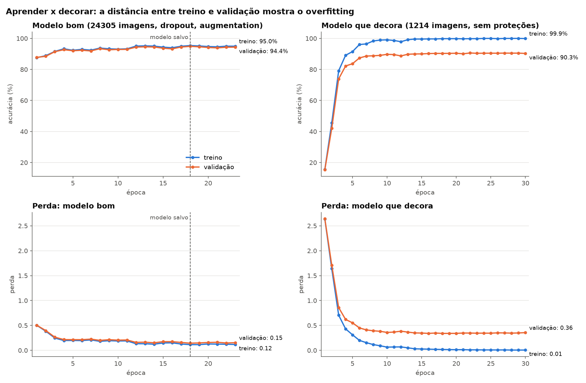
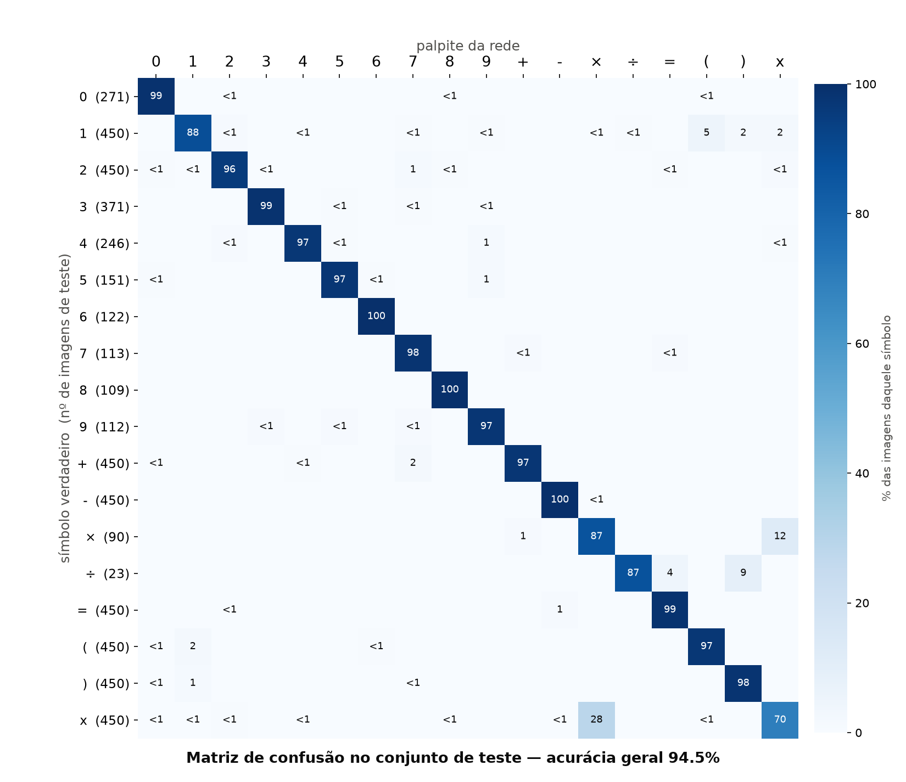
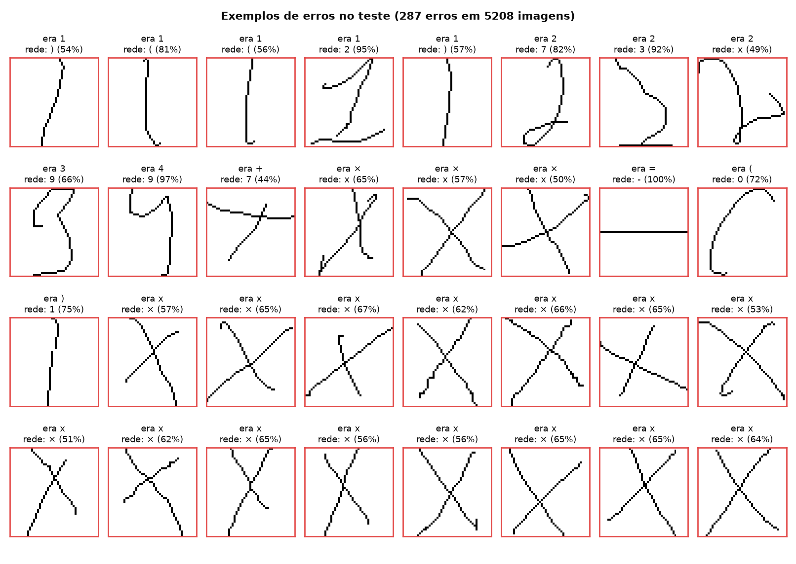
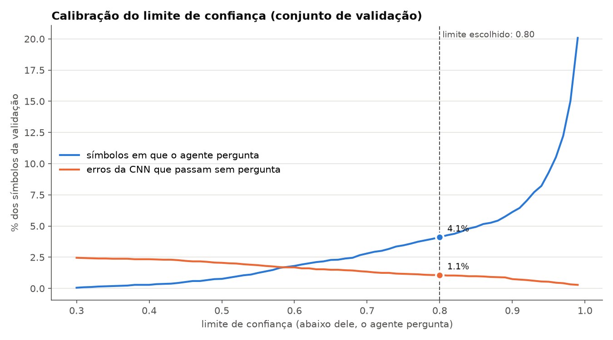

# 🧮 Tutor de Matemática que Lê sua Letra

O visitante escreve uma conta no papel, como `12 + 7 × 3`, e mostra para a webcam. O tutor **lê a letra** com uma rede neural treinada do zero, **resolve** a conta com um matemático exato (SymPy) e **explica passo a passo**, em português, com um LLM que roda no próprio notebook, **sem internet**.

Projeto individual de graduação que junta duas matérias:

- **Redes Neurais:** uma CNN treinada do zero reconhece 17 símbolos escritos à mão.
- **LLMs e Agentes Inteligentes:** um agente com LLM local decide o que fazer, usa ferramentas, explica e confere a conta.

---

## Como funciona



1. **Visão computacional (OpenCV):** encontra a folha na imagem (ignorando mão, roupa e fundo), separa a tinta do papel e recorta cada símbolo, juntando partes como os dois traços do `=` e os pontos do `÷`.
2. **Rede neural (CNN):** classifica cada símbolo entre 17 classes (`0`–`9`, `+ − × ÷ = ( )` e a incógnita `x`) e diz o quanto tem certeza.
3. **Agente (LLM + ferramentas):**
   - **percebe** a leitura;
   - **decide** se precisa perguntar (símbolo duvidoso) ou se pode calcular;
   - **usa ferramentas** (o LLM nunca faz conta: quem calcula é o SymPy);
   - **confere** cada número da explicação antes de mostrar.
4. **Interface (Gradio) e voz (pyttsx3):** mostra a leitura com a confiança de cada símbolo, a conversa com o tutor e, se quiser, fala a resposta.

---

## Como rodar

### Pré-requisitos (uma vez só)

- Windows com **Python 3.11**, **Git** e **[Ollama](https://ollama.com)** instalados.
- O modelo de linguagem:
  ```powershell
  ollama pull qwen3:4b-instruct
  ```
- O ambiente do projeto, na pasta do projeto:
  ```powershell
  python -m venv .venv
  .\.venv\Scripts\Activate.ps1
  pip install -r requirements.txt
  ```
  Se o PowerShell bloquear a ativação, rode `Set-ExecutionPolicy -Scope CurrentUser RemoteSigned`.
- O modelo treinado `models/cnn_simbolos.keras`. Por ser grande, ele **não vai para o Git**. Para gerá-lo, veja [Reproduzir o treino](#reproduzir-o-treino).

### Abrir o tutor

Dê **dois cliques em `iniciar.bat`**. Ele abre o Ollama (se estiver fechado), carrega a rede neural, o LLM e a voz, e abre o navegador em `http://localhost:7860`. Para fechar, feche a janela preta.

Pelo terminal, com o `.venv` ativado:

| Comando | O que faz |
| --- | --- |
| `python src/app.py` | abre a interface |
| `python src/verificar_ambiente.py` | confere se está tudo instalado (✅/❌) |
| `python src/leitor_webcam.py` | lê contas pela webcam, numa janela do OpenCV |
| `python src/testar_imagem.py` | classifica as fotos da pasta `fotos_teste/` |
| `python src/agente.py "12+7*3"` | conversa com o tutor pelo terminal |
| `python src/agente.py "12+7*3" --duvida 4=1` | simula um símbolo duvidoso |
| `python src/voz.py` | testa a voz |
| `python -m pytest` | roda os 141 testes automáticos |

### Dicas para a leitura dar certo

- Use **canetinha preta grossa** em **papel branco liso**, sem pauta nem quadriculado.
- Escreva a conta **em uma linha**, com símbolos de uns 3 a 5 cm de altura.
- Ilumine bem a folha. Ela pode ser segurada na mão: o programa encontra a folha sozinho.
- Escreva no meio da folha: um símbolo que encosta na borda do papel pode ser descartado.
- Plano B: a aba **✏️ Desenhar** da interface, para escrever a conta com o mouse.

---

## Resultados

### 1. Dados

Dataset **[Handwritten Math Symbols](https://www.kaggle.com/datasets/xainano/handwrittenmathsymbols)** (Kaggle), imagens 45×45.

- **77% das imagens eram cópias exatas** (174.176 de 225.832; algumas apareciam até 11 vezes). Elas foram removidas **antes** da divisão; sem isso, o teste teria imagens já vistas no treino e a nota seria falsa.
- Restaram **34.722 imagens únicas**, com no máximo 3.000 por classe.
- Divisão estratificada com semente 42: **treino 24.305 · validação 5.209 · teste 5.208**.
- Classes desequilibradas (÷ tem só 157 imagens) foram compensadas com `class_weight` no treino.



Um **único pré-processamento** é usado no dataset e na webcam: tons de cinza → separar tinta do papel → recortar e centralizar → 45×45 → afinar o traço.



### 2. A rede aprende ou decora?

CNN com 3 blocos de convolução (32, 64 e 128 filtros) + batch normalization, densa de 128 com dropout e saída de 17 classes (~505 mil parâmetros), **treinada do zero na CPU**.

| Modelo | Dados de treino | Proteções | Treino | Validação | Diferença |
| --- | --- | --- | --- | --- | --- |
| **Bom** | 24.305 (100%) | augmentation, dropout, early stopping | 95,4% | **94,9%** | 0,5 ponto |
| **Que decora** | 1.214 (5%) | nenhuma | **99,9%** | 90,3% | 9,6 pontos |

O modelo que decora acerta quase 100% das imagens que já viu, mas erra mais nas novas. As curvas de treino e validação **se afastam**. No modelo bom, elas andam juntas.



### 3. Nota final (conjunto de teste, usado uma única vez)

**Acurácia no teste: 94,5%** (4.921 de 5.208), praticamente igual à validação (94,9%): a rede **generaliza**. A média de acerto por classe é 94,8%.



A maior confusão é entre a **incógnita `x` e o sinal `×`** (28% dos `x` foram lidos como `×`). Como **não se pode retreinar olhando o teste**, isso foi resolvido pelo **contexto** no agente: em `2×+3=11` o símbolo só pode ser a incógnita, e em `3x4` só pode ser multiplicação.



### 4. Quando o agente pergunta

Se a confiança da CNN em um símbolo fica abaixo de **80%**, o agente pergunta antes de calcular ("Não tenho certeza do 4º símbolo. Ele é 7 ou 1?"). O limite foi escolhido com o conjunto de **validação**: com 0,80, o agente pergunta em só **4,1%** dos símbolos, e os erros que passariam despercebidos caem de **2,5% para 1,1%**.



### 5. Agente

- **O LLM não faz contas:** ele chama a ferramenta `calcular` (SymPy, com um analisador próprio, **sem `eval()`**), que devolve os passos na ordem da escola.
- **Regras no código, não só no prompt:**
  - símbolo duvidoso → pergunta antes de calcular;
  - LLM esqueceu a ferramenta → o código calcula mesmo assim;
  - a resposta do visitante a um exercício é conferida pelo SymPy.
- **Conferência (Chain of Verification):** toda "conta = resultado" escrita na explicação é recalculada. Se houver erro, o LLM refaz (até 3 vezes). Se ainda assim errar, ou se o Ollama estiver fechado, aparece uma explicação automática montada dos passos do SymPy.
- **Tempo** (notebook Ryzen 5 4600H, só CPU):
  - explicação: 13 a 23 s;
  - exercício: cerca de 9 s;
  - pergunta de dúvida: instantânea.

### 6. Teste com pessoas reais

- **Fotos do autor** (folha segurada na mão, com prateleira e camisa ao fundo): 4 de 4 símbolos certos (`÷`, `+`, `x`, `−`), depois da detecção automática da folha. Antes dela, o fundo virava dezenas de "símbolos" inventados.
- **Ensaio sem internet, à noite, com luz fraca vindo de um lado** e a cabeça de quem segurava a folha aparecendo atrás dela: a conta `4 + 5 × 2` foi lida certa nas 3 capturas, com 15 de 15 símbolos certos. A 1ª versão da detecção da folha errou essas capturas; a correção mede o papel com a luz já corrigida e descarta manchas cheias (cabelo) e marcas fracas do verso do papel.
- **Outras pessoas:** registrado em [`reports/testes_com_pessoas.md`](reports/testes_com_pessoas.md).

### 7. Ensaio final (sem internet)

- O Tutor só se comunica com o próprio computador (`127.0.0.1`). Rede neural, LLM, voz e interface rodam localmente.
- Única conexão externa vista no ensaio: o aplicativo do Ollama procurando atualizações. Ele funciona normalmente sem internet.
- **Memória:** LLM ≈ 3,2 GB + Tutor ≈ 0,8 GB ≈ **4 GB** dos 8 GB do notebook.

### 8. Testes automáticos

**141 testes** com `pytest`. Eles cobrem:

- pré-processamento;
- segmentação, incluindo uma cena bagunçada com "prateleira", "camisa" e "dedos";
- ferramentas de cálculo;
- agente, com um LLM falso que erra de propósito;
- interface;
- voz.

Um teste confere que o código das ferramentas não usa `eval`, `exec` nem `sympify`. Outro confere que a calibração nunca usa o conjunto de teste.

---

## Limitações

- **Letra muito diferente da do dataset** (outro estilo de `1`, `7` ou `x`) reduz a confiança; o agente então pergunta mais.
- **Traço fino ou claro** (esferográfica azul a meio metro) quase não aparece na imagem da webcam.
- **Só contas em uma linha:** frações empilhadas, potências, raízes e decimais ficam fora do escopo.
- **Equações só do 1º grau**, com uma incógnita (`x`).
- **Os pares `x`/`×` e `1`/`(`/`)`** são os mais confundidos pela CNN. O primeiro é resolvido pelo contexto; o segundo, perguntando ao visitante.
- **LLM na CPU:** cerca de 15 s por explicação. A explicação só aparece depois de conferida, então não é mostrada palavra por palavra.
- **RAM:** com 8 GB, convém fechar outros programas (editor de código, abas do navegador) durante a apresentação.
- **Tinta vermelha, laranja ou amarela** é ignorada de propósito, para não confundir com logotipos e dedos.

---

## Reproduzir o treino

1. Baixe o dataset do Kaggle e extraia em `data/raw/`.
2. Rode, em ordem:

```powershell
python src/preparar_dados.py   # remove duplicatas, divide 70/15/15 e gera as figuras dos dados
python src/treinar.py          # treina o modelo bom e o que decora (~20 min na CPU)
python src/avaliar.py          # avalia no teste (só na 1ª vez; depois reaproveita os palpites salvos)
python src/calibrar_confianca.py
```

O conjunto de teste foi usado **uma única vez** (22/11/2026). `avaliar.py` guarda os palpites e não reavalia sem `--reavaliar`.

---

## Estrutura

```
tutor-matematica/
├── iniciar.bat              # abre tudo com dois cliques
├── src/
│   ├── config.py            # classes, caminhos, limite de confiança, nome do LLM
│   ├── preprocessamento.py  # a função ÚNICA de pré-processamento
│   ├── preparar_dados.py    # Etapa 1: limpeza e divisão do dataset
│   ├── modelo.py, treinar.py, avaliar.py      # Etapas 2 e 3: a CNN
│   ├── segmentacao.py       # Etapa 4: acha a folha e recorta os símbolos
│   ├── leitor_webcam.py, testar_imagem.py
│   ├── ferramentas.py       # Etapa 5: cálculo passo a passo (SymPy, sem eval)
│   ├── agente.py, calibrar_confianca.py       # Etapa 6: o agente
│   ├── app.py               # Etapa 7: a interface
│   └── voz.py               # Etapa 8: a voz
├── tests/                   # 141 testes automáticos
├── reports/                 # resultados e figuras
└── PROGRESSO.md             # diário do projeto, etapa por etapa
```

Tecnologias: Python 3.11 · TensorFlow/Keras (CPU) · OpenCV · SymPy · Ollama (`qwen3:4b-instruct`) · Gradio · pyttsx3 · Matplotlib · pytest.

Desenvolvido com o apoio de um assistente de IA (Claude Code), etapa por etapa, com cada etapa testada e aprovada antes da seguinte (veja o [`PROGRESSO.md`](PROGRESSO.md)).
